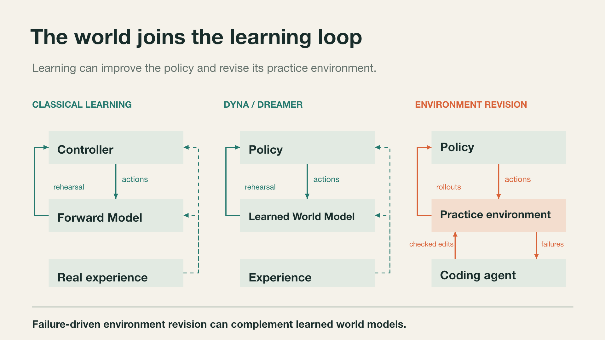
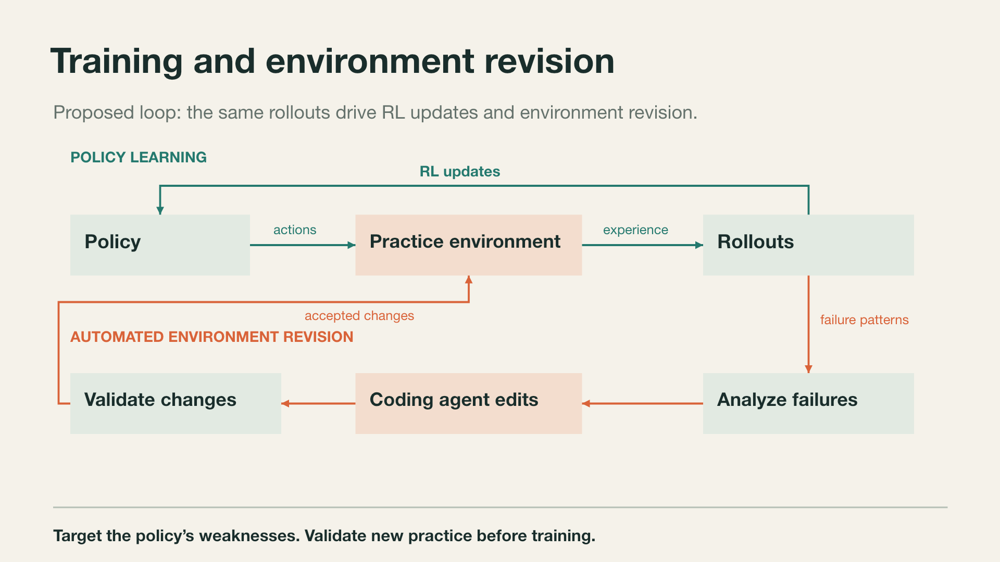
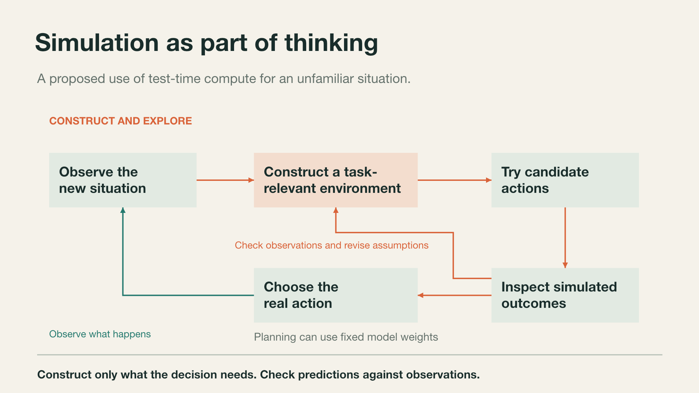

Imagine getting stuck on a hard math problem. A mentor suggests several problems that isolate steps you are missing, which you solve.
You return to the original problem, and this time you quickly discover the solution.

The mentor changed what you practice in response to where you struggle. 
This is useful for training agents too. 
When a model fails during RL tuning, beyond updating weights, we can alter the situations it encounters next. 
A late warning from a video assistant might motivate practice with tighter intervention windows. 
A slipping robotic grasp might motivate cases that isolate a difficult contact condition.

Recent advances in coding agents has made online *visual environment* revision viable. 
Run rollouts, identify weaknesses, modify practice tasks suitably, and repeat.
This further extends to test-time compute. 
Constructing live executable environments and experimenting with possible actions within this digital twin is now a possibility. 
This aligns with human reasoning too; revisit the last time you played pool when you possibly imagined the many possibilities before taking a shot. 
Building and running a simulation can become part of the agent's test-time reasoning.

These are two key ways that *visual environments join the loop*: adaptive practice during training, and online simulation as test time compute. 
Coding agents make the continuous revision of these environments realistic. 
We explore these ideas taking **live video assistance** and **robotic control** as case studies.

<figure>
  <iframe class="pool-opening-demo" src="/assets/blog/pool-opening/index.html" title="Think before the shot: explore possible pool shots, then play one" loading="eager"></iframe>
  <figcaption class="page__meta">Try possible shots before choosing one. A simplified illustration of simulation as part of thinking.</figcaption>
</figure>

## A familiar idea: try before acting

Robotics and reinforcement learning have a long history of using predictive models to examine the consequences of actions and improve behavior ([Jordan and Rumelhart](https://people.eecs.berkeley.edu/~jordan/papers/distal.pdf); [Dyna](https://mlanthology.org/icml/1990/sutton1990icml-integrated/)). Works such as [Dreamer](https://openreview.net/pdf?id=S1lOTC4tDS) further demonstrate how model-generated experience can improve agent behavior.

Alongside latent world models, explicit executable environments offer inspectable objects, rules, and parameters ([WorldCoder](https://arxiv.org/abs/2402.12275)), while physics engines provide a foundation for capturing task-relevant physical dynamics. A further shift is agent-driven revision: agents construct or modify these environments in response to learning failures ([ACCEL](https://proceedings.mlr.press/v162/parker-holder22a.html), [EnvGen](https://arxiv.org/abs/2403.12014), [Eurekaverse](https://arxiv.org/abs/2411.01775), [WEDGE](https://arxiv.org/abs/2610.19420)) or new observations ([Twin](https://arxiv.org/abs/2608.14490), [EMPIRIC](https://arxiv.org/abs/2609.35047)). 
These advances motivate integrating online environment modification directly into learning and reasoning. 

<figure>
  
  <figcaption class="page__meta">Related approaches to learning from consequences. Failure-driven revision of an executable environment can complement learned world models.</figcaption>
</figure>

## The environment became easier to revise

Coding agents have made editting simulators much easier while allowing extreme levels of detailed modification. 
Karpathy’s [A Long-expected Party](https://karpathy.ai/lotr-movie/) illustrates how specific a generated scene can be, and especially how coding agents can perform highly detailed edits that are unrealistic for humans to perform. 

In robotics, works like [RoboGen](https://generativesimulation.github.io/) and [RoboCasa](https://arxiv.org/abs/2406.02523) already automate parts of environment and task creation, providing foundations for the online, failure-driven revision.
Recent [Interactive Visual Gym](https://arxiv.org/abs/2611.08286) studies closed-loop assistance through executable environments and responsive simulated users for live video assistants. 
The ability to quickly edit environments (or simulated humans within then) gives us control over the practice conditions.

The kitchen below illustrates a simple case of environment controls. Two animated hands prepare a burger while a rule-based assistant provides guidance. Change the ingredient order, response delay, or distraction level, and observe whether the intervention changes the outcome. 

<figure>
  <iframe class="practice-demo" src="/assets/blog/kitchen-patch/index.html" title="Interactive procedural guidance: patch a kitchen and change the timing of advice" loading="lazy"></iframe>
  <figcaption class="page__meta">An illustrative, rule-based example. Scene changes, user behavior, and intervention timing are editable parts of the practice problem.</figcaption>
</figure>

## Two ways the environment joins the loop

Editable visual worlds can dynamically change what an agent practices or help explore the decision-space at inference. 
Both involve rapidly constructing or modifying the visual environment continuously.

  

    <button class="environment-loops__tab" id="loop-tab-training" type="button" aria-controls="loop-panel-training">During training</button>
    <button class="environment-loops__tab" id="loop-tab-test-time" type="button" aria-controls="loop-panel-test-time">At test time</button>
  

  

    <figure>
      
      <figcaption class="page__meta">Failures guide new practice; accepted environments feed further policy learning.</figcaption>
    </figure>
  

  

    <figure>
      
      <figcaption class="page__meta">Simulated outcomes guide the current action; new observations check the model.</figcaption>
    </figure>
  

### During training: failures shape the next practice

We revisit our live video assistance case study. 
Each practice episode (during RL tuning phase) should target a weakness while remaining within reach of the current model. 
The successful and failed rollouts jointly guide what the assistant already handles, where it sometimes succeeds, and which situations require simpler intermediate practice. 
Work such as [EnvGen](https://arxiv.org/abs/2403.12014), [Eurekaverse](https://arxiv.org/abs/2411.01775), and [WEDGE](https://arxiv.org/abs/2610.19420) uses performance feedback to target subsequent practice. 
Coding agents are capable of modifications at even higher detail and abstraction. 
We illustrate some examples relevant to our earlier simple kitchen environment.

| Missing Skill | Example Modification |
|---|---|
| Procedural dependencies | Modified recipe where an ingredient substitution changes required steps |
| Long-term consequences | Skip early step causing problems several steps later |
| Identify invalid plan | Missing some equipment requires a modified procedure |
| Failure Recovery | Human misunderstands instruction, creating a recoverable mistake |

Coding agents enable automating the entire process of discovering such missing skills from prior rollouts, and constructing suitable modified tasks for the subsequent rollouts. 
This new setting allows unlocking powerful training strategies for visual agents. 

### At test time: simulation becomes part of thinking

Next lets discuss test-time simulation in the context of robot control. 
An editable environment becomes part of how the robot thinks through a new situation. 
It builds simulations covering what matters for the current decision, and rehearses possible actions within multiple variants of those visual worlds. This spends test-time compute on exploration within editable visual worlds.

Consider peeling a banana, where too little grip creates slipping, but too much damages the fruit. 
Our animation below lets you vary attributes of both the policy and the world, illustrating the extended scope of test-time exploration.

<figure>
  <iframe class="practice-demo" src="/assets/blog/banana-peel/index.html" title="Robotic banana peeling: vary softness, grip force, and peel resistance" loading="lazy"></iframe>
  <figcaption class="page__meta">A scripted deformation and control illustration. Force, slip, and damage are heuristic, unitless signals, not measured physics. It does not model material fracture or demonstrate a learned robotic policy.</figcaption>
</figure>

We outline one possible test-time exploration for our same banana example:

| Step | Description | Supporting tools |
| --- | --- | --- |
| Reconstruct | Initial estimate of banana's shape and robots grasp | Depth or multi-view reconstruction |
| Identify physics | Estimate attributes like friction, stiffness, or peel resistance |  Coding agent world knowledge integrated with physics engines like [Isaac Sim](https://docs.isaacsim.omniverse.nvidia.com/latest/physics/simulation_fundamentals.html) or [MuJoCo](https://mujoco.readthedocs.io/en/stable/modeling.html) |
| Rehearse | Compare grip-and-pull actions across plausible material properties. | Coding agent modifies environment and executes robot policy |
| Test and repeat | Observe and analyse the new rollouts. | Visual and environment-state based feedback used by coding agent |

The infrastructure for this full automated pipline now exists. Agents can assemble, test, and revise task-specific simulations iteratively at test-time. 
Works like [EMPIRIC](https://arxiv.org/abs/2609.35047) provide a foundation for this direction of test-time environment modification.

## What this all means

Visual environment design can now become part of the iterative agent improvement loop. 
We observe an agent’s skill level and failure modes, and modify the visual world suitably. 
Similar environment or task modification is already established in non-visual tasks such as [theorem proving](https://arxiv.org/abs/2502.00212), [code reasoning](https://arxiv.org/abs/2505.03335), [language tasks](https://arxiv.org/abs/2510.24684), [code repair](https://arxiv.org/abs/2607.03523), and [test-time code generation](https://arxiv.org/abs/2605.23491). 
In coding tasks, these ideas have recently proven useful even for large-scale training, with [Microsoft](https://arxiv.org/html/2609.07925#S3.SS1) leveraging policy-guided task revision and [DeepSeek](https://arxiv.org/html/2609.19969v1#S5.SS1.SSS1) exploring failure-informed training-environment construction. 

The ability to similarly construct and modify *visual worlds* opens pathways to scaling up interactive visual agents. 
Recent advances in physical AI (e.g. [Tesla FSD](https://x.com/birdabo/status/2124466600476921886?s=46)) only further support this direction.
Leveraging editable visual worlds to scale both learning and test-time compute is a promising pathway to building truly inteligent interactive visual agents. 